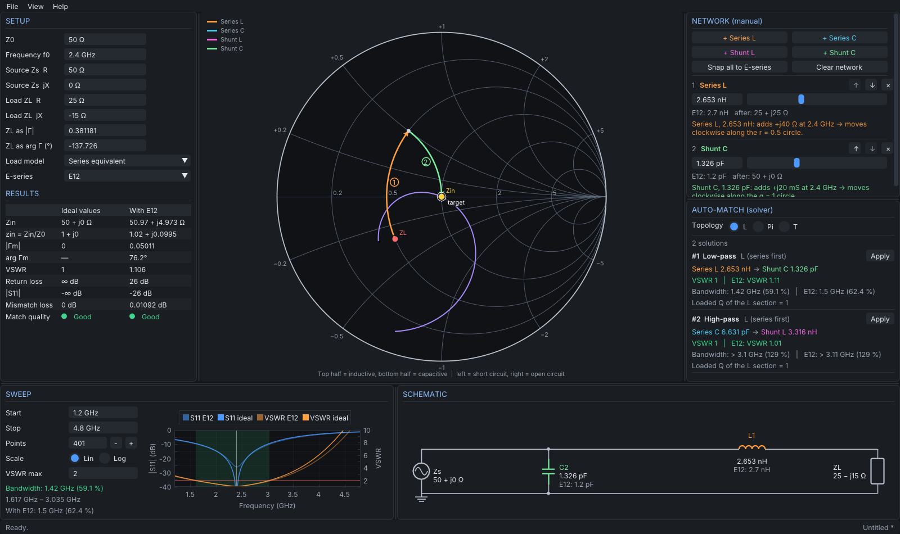

# SmithMatch

**Design L/C impedance-matching networks with an interactive Smith chart.**
Desktop app for Windows and macOS, written in C++17 with Dear ImGui. Free and open source (MIT).



## Features

- **Smith chart** with impedance and optional admittance grids, coloured paths for every element (series L / series C / shunt L / shunt C), VSWR circle and a hover read-out of Z, Y and Γ.
- **Manual mode**: add, edit, reorder and delete inductors and capacitors; every change updates the chart, the results, the sweep and the schematic instantly.
- **Automatic solver**: all L-network solutions (shunt-first and series-first, classified low-pass / high-pass / mixed), plus **Pi** and **T** networks with a chosen nominal Q. Hover a solution to preview it on the chart, press *Apply* to use it.
- **Complex source and load**: the target is the conjugate of the source impedance; Γm = (Zin − Zs\*)/(Zin + Zs).
- **Frequency sweep**: |S11| and VSWR curves, bandwidth for a VSWR limit, and the Zin(f) locus on the chart. Three load models (constant, series R+L/C, parallel G+C/L).
- **Real components**: E12 / E24 rounding, with ideal and rounded results side by side.
- **Schematic** of the network, **Learn mode** tooltips that explain what each element does on the chart.
- **Files**: save/open projects (`.smith.json`), export the chart as **PNG** and the sweep as **CSV**.
- Dark theme, crisp on HiDPI / Retina screens.

## Download

Ready-to-use packages are attached to each [release](../../releases):

| Platform | File |
|---|---|
| Windows | `SmithMatch-<version>-Windows-x64.zip` — unzip and run `SmithMatch.exe` (no installation, no extra DLL) |
| macOS (Apple Silicon and Intel) | `SmithMatch-<version>-macOS.dmg` — drag `SmithMatch.app` to *Applications* |

### The app is not signed — what you will see

SmithMatch is a free project and is **not code-signed or notarized**, so your system may warn you the first time:

- **macOS**: if the app is blocked, open **System Settings → Privacy & Security**, scroll down to the message about SmithMatch and click **Open Anyway** (on recent macOS versions, right-click → Open is no longer enough). An app that you build yourself from source is not affected.
- **Windows**: SmartScreen may show "Windows protected your PC". Click **More info → Run anyway**.

## Quick start

1. Launch SmithMatch: it opens with an example — an antenna of **25 − j15 Ω at 2.4 GHz** matched to **50 Ω**.
2. In **AUTO-MATCH**, hover a solution to preview it, then click **Apply**: the Zin point lands on the centre of the chart (VSWR = 1).
3. Look at the **SWEEP** panel for the bandwidth, and pick **E12** in SETUP to see the effect of standard component values.

The full walkthrough is in [`docs/USER_GUIDE.md`](docs/USER_GUIDE.md) (French).

## Build from source

Requirements: a C++17 compiler (MSVC from *Build Tools for Visual Studio 2022*, or Xcode command-line tools / Clang), **CMake ≥ 3.24** and an Internet connection for the first configure (dependencies are fetched with pinned versions).

```bash
cmake -S . -B build -DCMAKE_BUILD_TYPE=Release
cmake --build build --config Release --parallel
ctest --test-dir build -C Release --output-on-failure
```

- Windows executable: `build/Release/SmithMatch.exe` — macOS app: `build/SmithMatch.app`
- Installer packages (`.zip` on Windows, `.dmg` on macOS): `cmake --build build --config Release --target package`

Step-by-step instructions for Windows and macOS (tools, VS Code, troubleshooting) are in [`docs/BUILD.md`](docs/BUILD.md) (French).

## Documentation (French)

| File | Content |
|---|---|
| [`docs/USER_GUIDE.md`](docs/USER_GUIDE.md) | user guide with a complete worked example |
| [`docs/MATHS.md`](docs/MATHS.md) | every formula used, with the numeric test examples |
| [`docs/ARCHITECTURE.md`](docs/ARCHITECTURE.md) | modules and data flow |
| [`docs/BUILD.md`](docs/BUILD.md) | building on Windows and macOS |
| [`CLAUDE.md`](CLAUDE.md) | permanent project rules and physical conventions |

## Project layout

```
src/core/   calculation engine (no graphics dependency, unit-tested)
src/ui/     Dear ImGui interface; src/ui/platform/ for OS-specific code
tests/      doctest unit tests of src/core/
cmake/      dependencies, font embedding, packaging
docs/       documentation
```

The engine uses SI units internally, never throws exceptions for expected errors, and every physical formula has a reference-value test (for example Pozar, *Microwave Engineering*, example 5.1).

## Not in v0.2 (ideas for later)

Resistors, transmission lines and stubs, finite component Q, Touchstone `.s1p` import, drag-and-drop on the chart, undo/redo, constant-Q circles, a web version, code signing. The architecture already leaves room for them (see `docs/ARCHITECTURE.md`).

## License

SmithMatch is released under the [MIT License](LICENSE) — Copyright (c) 2026 Téo Vidal.
Third-party components and their licenses (Dear ImGui, ImPlot, GLFW, nlohmann/json, nativefiledialog-extended, stb, doctest, Inter font) are listed in [`THIRD_PARTY_LICENSES.md`](THIRD_PARTY_LICENSES.md).
